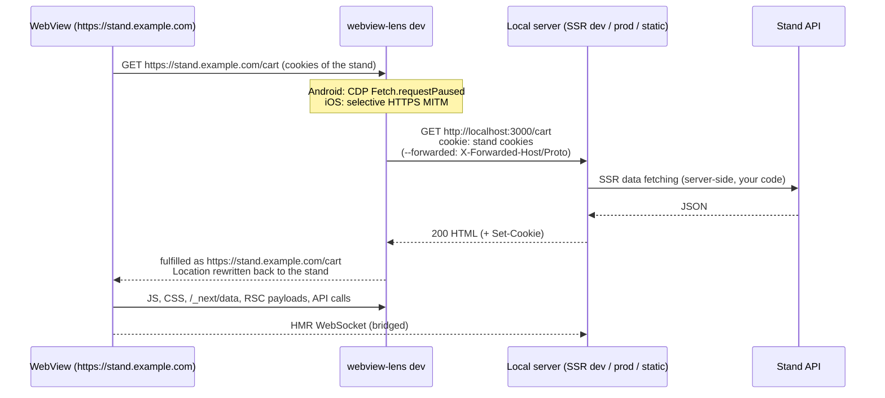

# SSR и SSG внутри WebView

`webview-lens` всё равно, как получен HTML: страница с серверным рендерингом (SSR), заранее
сгенерированный статический сайт (SSG) и чисто клиентское SPA проходят один и тот же путь. Здесь
описано, как всё складывается в каждом режиме рендеринга и как подключить `dev`, `vitals` и RUM в
**Next.js**, **Nuxt**, **SvelteKit** и **Angular**.

## Как идёт запрос



Что SSR-приложение получает без дополнительной настройки:

- **Cookies стенда** доходят до вашего SSR-сервера (`Network.getCookies` на Android, сам запрос на
  iOS), поэтому рендеринг, зависящий от сессии, работает как на стенде.
- **`Set-Cookie` от вашего сервера** ставится на домен стенда: локально отрендеренный вход в аккаунт
  продолжает работать в приложении.
- **Редиректы** (`Location: http://localhost:3000/login`) переписываются обратно на origin стенда.
- **Нативный бридж, User-Agent, safe areas и скрипты, которые внедряет приложение**, остаются
  настоящими: WebView не уходит с origin стенда.

## Режимы рендеринга

| Режим                           | Локальный сервер для `--cmd` / `local-url`                                                   | Примечания                                                                         |
| ------------------------------- | -------------------------------------------------------------------------------------------- | ---------------------------------------------------------------------------------- |
| SSR, dev-сервер                 | `next dev`, `nuxt dev`, `vite dev` (SvelteKit), `ng serve` (Angular SSR)                     | HMR через проброшенный WebSocket. Цифры нерепрезентативны (нет минификации).       |
| SSR, production-сборка          | `next start`, `node .output/server/index.mjs`, `node build`, `node dist/*/server/server.mjs` | На ней запускайте `webview-lens vitals`.                                           |
| SSG / prerender (статика)       | любой статический сервер над папкой сборки (`npx serve out -l 4173`)                         | `--preset generic`. Эндпоинты RUM живут на отдельном сервере (см. раздел про SSG). |
| Гибрид (ISR, partial prerender) | production-сервер фреймворка                                                                 | Как SSR: WebView получает ровно то, что ответил сервер.                            |

### Команды для каждого фреймворка

```bash
# Next.js — SSR dev, затем production-сборка
npx webview-lens dev http://localhost:3000 --cmd "npm run dev"
npx webview-lens dev http://localhost:3000 --cmd "npm run build && npm start"
# Next.js — статический экспорт (output: 'export')
npx webview-lens dev http://localhost:4173 --preset generic --cmd "npx next build && npx serve out -l 4173"

# Nuxt — SSR dev, production-сервер, статическая генерация
npx webview-lens dev http://localhost:3000 --cmd "npx nuxi dev"
npx webview-lens dev http://localhost:3000 --cmd "npx nuxi build && node .output/server/index.mjs"
npx webview-lens dev http://localhost:4173 --preset generic --cmd "npx nuxi generate && npx serve .output/public -l 4173"

# SvelteKit — dev (Vite), сборка adapter-node, сборка adapter-static
npx webview-lens dev http://localhost:5173 --cmd "npm run dev"
npx webview-lens dev http://localhost:3000 --preset generic --cmd "npm run build && ORIGIN=http://localhost:3000 node build"
npx webview-lens dev http://localhost:4173 --preset generic --cmd "npm run build && npx serve build -l 4173"

# Angular — SSR dev-сервер, SSR production-сервер, prerender
npx webview-lens dev http://localhost:4200 --cmd "npx ng serve"
npx webview-lens dev http://localhost:4000 --preset generic --cmd "npx ng build && NG_ALLOWED_HOSTS=localhost node dist/my-app/server/server.mjs"
npx webview-lens dev http://localhost:4173 --preset generic --cmd "npx ng build && npx serve dist/my-app/browser -l 4173"
```

`--preset auto` определяет `next`, `nuxt`, `sveltekit` (`@sveltejs/kit`) и `angular` по
`package.json`. У production-сервера нет HMR-сокета, поэтому с `--preset generic` логи запросов
полные. Если приложение развёрнуто под подпутём (`basePath`, `app.baseURL`, `paths.base`,
`--base-href`), добавьте `--remote-base /shop`. Для iOS добавьте `--platform ios --remote https://stand.example.com`.

## Абсолютные URL: `--forwarded`

По умолчанию локальный сервер считает origin'ом себя: `Host: localhost:3000`, а `Origin` и
`Referer` переписываются на `http://localhost:3000`. Страницы рендерятся нормально, но всё, что
сервер собирает как **абсолютный URL**, указывает на localhost: canonical и Open Graph, ссылки в
sitemap, OAuth `redirect_uri`, ссылки в письмах, абсолютные редиректы из URL запроса.

`--forwarded` переводит `dev` в режим обратного прокси, как настоящий балансировщик перед приложением:

```
X-Forwarded-Host:   stand.example.com
X-Forwarded-Proto:  https
X-Forwarded-Port:   443
Forwarded:          host="stand.example.com";proto=https
X-Forwarded-Prefix: /shop            (только с --remote-base)
Origin / Referer:   остаются как на стенде
```

Origin и Referer не переписываются, чтобы CSRF-проверки фреймворков видели один и тот же origin. По фреймворкам:

| Фреймворк    | Что сделать при `--forwarded`                                                                                                                                                                                                                                                                                                                                                                                                                                                                                                                                                                                                                                                                                                              |
| ------------ | ------------------------------------------------------------------------------------------------------------------------------------------------------------------------------------------------------------------------------------------------------------------------------------------------------------------------------------------------------------------------------------------------------------------------------------------------------------------------------------------------------------------------------------------------------------------------------------------------------------------------------------------------------------------------------------------------------------------------------------------ |
| Next.js      | Server Actions сверяют `Origin` с `X-Forwarded-Host`: в этом режиме они совпадают (проверено на Next.js 16 на Android и iOS, с `--forwarded` и без). HMR в `next dev` заработал без `allowedDevOrigins`; хост стенда добавляйте туда, только если `next dev` пишет о заблокированном cross-origin запросе к `/_next/*`.                                                                                                                                                                                                                                                                                                                                                                                                                    |
| Nuxt / Nitro | `getRequestURL(event, { xForwardedHost: true, xForwardedProto: true })` возвращает URL стенда с `--forwarded` и локальный без него (проверено на Nuxt 4 на Android и iOS, `nuxt dev` и сборка node-server). На странице сохраняйте серверное значение в `useState`: в браузере `useRequestURL()` читает `window.location`, поэтому после гидрации всегда показывает стенд. Встроенной CSRF-проверки в Nuxt нет; POST, который сверяет `Origin` с forwarded URL запроса, проходит в обоих режимах.                                                                                                                                                                                                                                          |
| SvelteKit    | `vite dev` собирает `url.origin` из `Host` и не читает forwarded-заголовки, поэтому `url.origin` остаётся локальным даже с `--forwarded`; CSRF-проверка в dev выключена, form actions проходят в обоих режимах. adapter-node строже: без `ORIGIN` он считает протокол `https`, и каждый form action получает `403 Cross-site POST form submissions are forbidden`. Без `--forwarded` задайте `ORIGIN` с локальным URL (`ORIGIN=http://localhost:3000`); с `--forwarded` задайте `PROTOCOL_HEADER=x-forwarded-proto HOST_HEADER=x-forwarded-host`, и `url.origin` будет адресом стенда (проверено на SvelteKit 3 на Android и iOS).                                                                                                         |
| Angular SSR  | Angular 22 рендерит только для разрешённых хостов и игнорирует `X-Forwarded-*`, пока им не доверяют (проверено на Android и iOS). `ng serve` разрешает локальный хост; production-сервер (`node dist/…/server.mjs`) отвечает **400** на любой запрос, пока `NG_ALLOWED_HOSTS` не содержит локальный хост (`NG_ALLOWED_HOSTS=localhost,127.0.0.1`). С `--forwarded` задайте ещё `NG_TRUST_PROXY_HEADERS=x-forwarded-host,x-forwarded-proto` и добавьте хост стенда в `NG_ALLOWED_HOSTS`, иначе будет 400 (`Header "x-forwarded-host" … is not allowed`); без настройки доверия заголовки отбрасываются с предупреждением и URL остаётся локальным. То же в коде делают опции `allowedHosts` и `trustProxyHeaders` у `AngularNodeAppEngine`. |

Без `--forwarded` в существующих настройках ничего не меняется: режим включается явно, в том числе
через `"forwarded": true` в `webview-lens.config.json`.

## RUM в SSR-приложениях

`webview-lens/rum` можно импортировать в код, общий для сервера и браузера: на сервере (без
`window`) репортеры и `beaconTransport` ничего не делают, а `captureGlobalErrors` возвращает
пустую функцию. И всё же запускайте отправку из кода, который выполняется **только в браузере**:
так она срабатывает один раз на загрузку страницы, а не на каждый серверный рендер. Обработчики
`webview-lens/rum/server` — функции Fetch API `Request → Response`, они работают в Node, Edge, Bun и Deno.

### Next.js (App Router)

```tsx
// app/web-vitals.tsx
'use client';

import { useEffect } from 'react';
import { useReportWebVitals } from 'next/web-vitals';
import {
    captureGlobalErrors,
    createErrorReporter,
    createVitalsReporter,
    detectWebViewEnv,
} from 'webview-lens/rum';

const context = () => ({ env: detectWebViewEnv() });
// На уровне модуля: Next.js переподписывается, если меняется ссылка на колбэк.
const report = createVitalsReporter({ context });
const reportError = createErrorReporter({ context });

export function WebVitals() {
    useReportWebVitals(report);
    useEffect(() => captureGlobalErrors(reportError), []);

    return null;
}
```

```ts
// app/api/vitals/route.ts  (так же для /api/timings и /api/client-log)
import { createVitalsHandler } from 'webview-lens/rum/server';

export const POST = createVitalsHandler({ onMetric: (m) => console.info(m) });
```

Отрендерите `<WebVitals />` в `app/layout.tsx`. Pages Router: `export const reportWebVitals = report;`
в `pages/_app.tsx`, а обработчики через `toNodeHandler` в `pages/api/*` с
`export const config = { api: { bodyParser: false } }`.

### Nuxt

```ts
// plugins/rum.client.ts  (.client: только в браузере)
import { onCLS, onFCP, onINP, onLCP, onTTFB } from 'web-vitals';
import {
    captureGlobalErrors,
    createErrorReporter,
    createVitalsReporter,
    detectWebViewEnv,
} from 'webview-lens/rum';

export default defineNuxtPlugin(() => {
    const context = () => ({ env: detectWebViewEnv() });
    const report = createVitalsReporter({ context });

    [onCLS, onINP, onLCP, onFCP, onTTFB].forEach((on) => on(report));
    captureGlobalErrors(createErrorReporter({ context }));
});
```

```ts
// server/api/vitals.post.ts
import { createVitalsHandler } from 'webview-lens/rum/server';

const vitals = createVitalsHandler({ onMetric: (m) => console.info(m) });

export default defineEventHandler((event) => vitals(toWebRequest(event)));
```

### SvelteKit

```ts
// src/hooks.client.ts  (выполняется один раз в браузере)
import { onCLS, onFCP, onINP, onLCP, onTTFB } from 'web-vitals';
import {
    captureGlobalErrors,
    createErrorReporter,
    createVitalsReporter,
    detectWebViewEnv,
} from 'webview-lens/rum';

const context = () => ({ env: detectWebViewEnv() });
const report = createVitalsReporter({ context });

[onCLS, onINP, onLCP, onFCP, onTTFB].forEach((on) => on(report));
captureGlobalErrors(createErrorReporter({ context }));
```

```ts
// src/routes/api/vitals/+server.ts
import type { RequestHandler } from './$types';
import { createVitalsHandler } from 'webview-lens/rum/server';

const vitals = createVitalsHandler({ onMetric: (m) => console.info(m) });

export const POST: RequestHandler = ({ request }) => vitals(request);
```

### Angular (SSR)

```ts
// src/app/app.component.ts — afterNextRender выполняется только в браузере
import { Component, afterNextRender } from '@angular/core';
import { onCLS, onFCP, onINP, onLCP, onTTFB } from 'web-vitals';
import {
    captureGlobalErrors,
    createErrorReporter,
    createVitalsReporter,
    detectWebViewEnv,
} from 'webview-lens/rum';

@Component({ selector: 'app-root', templateUrl: './app.component.html' })
export class AppComponent {
    constructor() {
        afterNextRender(() => {
            const context = () => ({ env: detectWebViewEnv() });
            const report = createVitalsReporter({ context });

            [onCLS, onINP, onLCP, onFCP, onTTFB].forEach((on) => on(report));
            captureGlobalErrors(createErrorReporter({ context }));
        });
    }
}
```

```ts
// src/server.ts — регистрируйте до любого body parser: toNodeHandler читает сырой поток
import { createVitalsHandler, toNodeHandler } from 'webview-lens/rum/server';

app.post('/api/vitals', toNodeHandler(createVitalsHandler({ onMetric: (m) => console.info(m) })));
```

### Другой рендеринг внутри WebView

`detectWebViewEnv(userAgent)` работает и на сервере с User-Agent запроса: Next.js
`(await headers()).get('user-agent')`, Nuxt `useRequestHeaders(['user-agent'])`, SvelteKit
`event.request.headers.get('user-agent')` в `hooks.server.ts`, Angular `inject(REQUEST)`. Если от
результата зависит HTML, передайте серверный результат клиенту (props, `useState`, данные страницы),
а не определяйте заново в браузере, иначе гидрация разойдётся. Если SSR-ответы кеширует CDN,
отправляйте `Vary: User-Agent`. SSG-страница не может зависеть от User-Agent: определяйте на клиенте.

## SSG: RUM без своего сервера

У статического сайта нет маршрутов `/api/*`, поэтому направьте репортеры на отдельный API-хост и
разрешите origin сайта в обработчиках:

```ts
// на статическом сайте
const report = createVitalsReporter({ endpoint: 'https://rum.example.com/api/vitals' });
```

```ts
// на rum.example.com (Node, Workers, Lambda, функция Vercel/Netlify…)
export const POST = createVitalsHandler({
    onMetric: (m) => console.info(m),
    allowOrigin: ['https://www.example.com'],
});
```

Beacon на чужой origin отправляется как `text/plain`. Это CORS-safelisted тип, браузер шлёт его без
preflight, а обработчики разбирают тело при любом Content-Type. `allowOrigin` добавляет
`Access-Control-Allow-Origin` и отвечает на preflight `OPTIONS` для клиентов, которые шлют JSON через
свой `transport`. Используйте шаблоны маршрутов (`path: () => '/blog/[slug]'`), чтобы тысячи
сгенерированных страниц сводились к нескольким рядам метрик.

### Заголовки кэша у пререндеренного HTML

Отдавайте пререндеренный HTML с `Cache-Control: no-cache` (или коротким `max-age`). Без
`Cache-Control` заголовок `Last-Modified` позволяет WebView закэшировать страницу эвристически
(примерно на десятую часть её возраста), и после деплоя приложение может показывать старый HTML. В
прогонах на устройствах так отдавал пререндеренную страницу Nuxt 4, и Android WebView, и WKWebView
показывали её даже после переключения на другую сборку. Next.js шлёт `s-maxage` (только для CDN),
SvelteKit и Angular — только `ETag`. В Nuxt помогает
`routeRules: { '/static': { prerender: true, headers: { 'cache-control': 'no-cache' } } }`; в остальных
случаях задайте заголовок на CDN или обратном прокси.

`CLS` и `LCP` отправляются, когда страница скрывается (переход на другую страницу, приложение ушло в
фон). Ждите их на коллекторе после того, как пользователь ушёл со страницы, а не пока она открыта.

## Замеры: `webview-lens vitals`

- Запускайте на **production-сборке** (`next start`, `node .output/server/index.mjs`, статический
  сервер), а не на dev-сервере.
- Для SSR в TTFB входят рендер и загрузка данных на вашем сервере: сравнивайте со стендом.
- Для SSG за CDN флаг `--cold` приближает первый визит; без него измеряется прогретый кеш.
- На iOS `CLS` — `n/a` (в WebKit нет событий layout-shift); `LCP` и `INP` есть только в свежих iOS (LCP измерен на iOS 26.6).

## Ограничения

- **Потоковый SSR в `dev` буферизуется.** CDP `Fetch.fulfillRequest` и MITM-прокси отдают ответ
  целиком, поэтому стриминг React/Vue/Svelte (Suspense, `renderToPipeableStream`) приходит одним
  куском. Рендеринг корректный, но постепенная отрисовка и TTFB в dev-режиме нерепрезентативны.
- **Server-Sent Events** нельзя отдать через CDP: см. `--sse` и `--bypass`.
- **Серверные запросы к стенду** делает ваш SSR-код со своей конфигурацией (base URL, учётные
  данные). `webview-lens` пересылает только запросы самого WebView.
