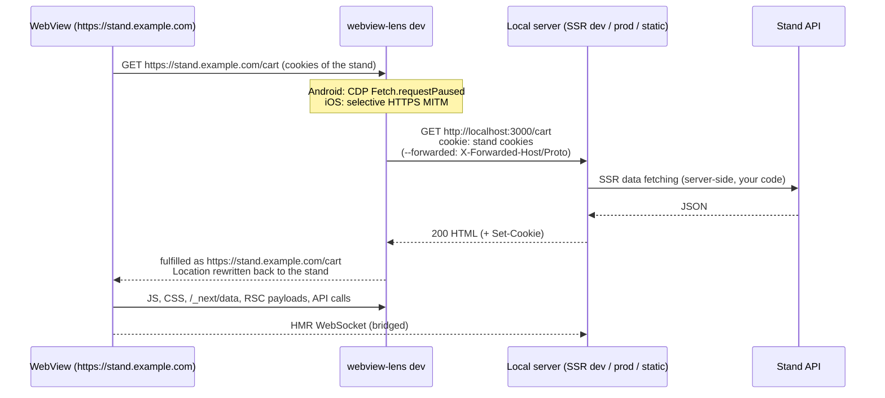

# SSR & SSG Inside a WebView

`webview-lens` does not care how HTML is produced: a server-rendered page (SSR), a prerendered static
site (SSG) and a client-only SPA all go through the same pipeline. This guide shows how the pieces fit
together for each rendering mode, and how to wire `dev`, `vitals` and RUM in **Next.js**, **Nuxt**,
**SvelteKit** and **Angular**.

## How a request flows



What this gives an SSR app for free:

- **Cookies of the stand** reach your SSR server (`Network.getCookies` on Android, the real request on
  iOS), so session-dependent rendering works as on the stand.
- **`Set-Cookie` from your server** lands on the stand's domain: login flows rendered locally keep
  working in the app.
- **Redirects** (`Location: http://localhost:3000/login`) are rewritten back to the stand origin.
- **Native bridge, User-Agent, safe areas and app-injected scripts** stay real: the WebView never
  leaves the stand origin.

## Rendering modes

| Mode                            | Local server for `--cmd` / `local-url`                                                       | Notes                                                                                  |
| ------------------------------- | -------------------------------------------------------------------------------------------- | -------------------------------------------------------------------------------------- |
| SSR, dev server                 | `next dev`, `nuxt dev`, `vite dev` (SvelteKit), `ng serve` (Angular SSR)                     | HMR over the bridged WebSocket. Numbers are not representative (no minification).      |
| SSR, production build           | `next start`, `node .output/server/index.mjs`, `node build`, `node dist/*/server/server.mjs` | What to run `webview-lens vitals` against.                                             |
| SSG / prerender (static files)  | any static server over the output folder (`npx serve out -l 4173`)                           | Use `--preset generic`. RUM endpoints must live on a server elsewhere (see SSG below). |
| Hybrid (ISR, partial prerender) | the framework's production server                                                            | Works like SSR: whatever the server answers is what the WebView gets.                  |

### Commands per framework

```bash
# Next.js — SSR dev, then production build
npx webview-lens dev http://localhost:3000 --cmd "npm run dev"
npx webview-lens dev http://localhost:3000 --cmd "npm run build && npm start"
# Next.js — static export (output: 'export')
npx webview-lens dev http://localhost:4173 --preset generic --cmd "npx next build && npx serve out -l 4173"

# Nuxt — SSR dev, production server, static generate
npx webview-lens dev http://localhost:3000 --cmd "npx nuxi dev"
npx webview-lens dev http://localhost:3000 --cmd "npx nuxi build && node .output/server/index.mjs"
npx webview-lens dev http://localhost:4173 --preset generic --cmd "npx nuxi generate && npx serve .output/public -l 4173"

# SvelteKit — dev (Vite), adapter-node build, adapter-static build
npx webview-lens dev http://localhost:5173 --cmd "npm run dev"
npx webview-lens dev http://localhost:3000 --preset generic --cmd "npm run build && node build"
npx webview-lens dev http://localhost:4173 --preset generic --cmd "npm run build && npx serve build -l 4173"

# Angular — SSR dev server, SSR production server, prerendered output
npx webview-lens dev http://localhost:4200 --cmd "npx ng serve"
npx webview-lens dev http://localhost:4000 --preset generic --cmd "npx ng build && node dist/my-app/server/server.mjs"
npx webview-lens dev http://localhost:4173 --preset generic --cmd "npx ng build && npx serve dist/my-app/browser -l 4173"
```

`--preset auto` detects `next`, `nuxt`, `sveltekit` (`@sveltejs/kit`) and `angular` from
`package.json`. A production server has no HMR socket, so `--preset generic` keeps the logs complete.
Add `--remote-base /shop` when the app is deployed under a base path (`basePath`, `app.baseURL`,
`paths.base`, `--base-href`). Add `--platform ios --remote https://stand.example.com` for iOS.

## Absolute URLs: `--forwarded`

By default your local server sees itself as the origin: `Host: localhost:3000`, and `Origin` /
`Referer` are rewritten to `http://localhost:3000`. Pages render fine, but anything the server builds
as an **absolute URL** points at localhost: canonical and Open Graph tags, sitemap links, OAuth
`redirect_uri`, email links, absolute redirects built from the request URL.

`--forwarded` switches `dev` into reverse-proxy mode, like a real load balancer in front of your app:

```
X-Forwarded-Host:   stand.example.com
X-Forwarded-Proto:  https
X-Forwarded-Port:   443
Forwarded:          host="stand.example.com";proto=https
X-Forwarded-Prefix: /shop            (only with --remote-base)
Origin / Referer:   kept as the stand's
```

Origin and Referer are kept so that framework CSRF checks see one consistent origin. Per framework:

| Framework    | What to do with `--forwarded`                                                                                                                                                                                                                                            |
| ------------ | ------------------------------------------------------------------------------------------------------------------------------------------------------------------------------------------------------------------------------------------------------------------------ |
| Next.js      | Server Actions compare `Origin` with `X-Forwarded-Host`: consistent in this mode. If `next dev` logs a blocked cross-origin request to `/_next/*`, add the stand host to `allowedDevOrigins`.                                                                            |
| Nuxt / Nitro | `useRequestURL({ xForwardedHost: true, xForwardedProto: true })` and `getRequestURL(event, { xForwardedHost: true, xForwardedProto: true })` return the stand URL.                                                                                                       |
| SvelteKit    | `vite dev` ignores forwarded headers and its CSRF check compares `Origin` with `Host`: **do not** use `--forwarded` with the dev server. With adapter-node set `HOST_HEADER=x-forwarded-host PROTOCOL_HEADER=x-forwarded-proto` (or `ORIGIN=https://stand.example.com`). |
| Angular SSR  | `@angular/ssr` builds the request URL from `X-Forwarded-Host/Proto`. If your version validates hosts, add the stand host to `allowedHosts`. With a custom Express `server.ts`, call `app.set('trust proxy', true)`.                                                      |

Without `--forwarded` nothing changes for existing setups: it is opt-in, also as
`"forwarded": true` in `webview-lens.config.json`.

## RUM in SSR apps

`webview-lens/rum` is safe to import in code shared by the server and the browser: reporters and
`beaconTransport` do nothing on the server (no `window`), and `captureGlobalErrors` returns a no-op
there. Still, start reporting from **client-only** code so it runs once per page load, not on every
server render. `webview-lens/rum/server` handlers are Fetch API `Request → Response` functions and run
in Node, Edge, Bun and Deno.

### Next.js (App Router)

```tsx
// app/web-vitals.tsx
'use client';

import { useEffect } from 'react';
import { useReportWebVitals } from 'next/web-vitals';
import {
    captureGlobalErrors,
    createErrorReporter,
    createVitalsReporter,
    detectWebViewEnv,
} from 'webview-lens/rum';

const context = () => ({ env: detectWebViewEnv() });
// Module scope: Next.js re-subscribes when the callback identity changes.
const report = createVitalsReporter({ context });
const reportError = createErrorReporter({ context });

export function WebVitals() {
    useReportWebVitals(report);
    useEffect(() => captureGlobalErrors(reportError), []);

    return null;
}
```

```ts
// app/api/vitals/route.ts  (same pattern for /api/timings and /api/client-log)
import { createVitalsHandler } from 'webview-lens/rum/server';

export const POST = createVitalsHandler({ onMetric: (m) => console.info(m) });
```

Render `<WebVitals />` in `app/layout.tsx`. Pages Router: `export const reportWebVitals = report;` in
`pages/_app.tsx` and the handlers through `toNodeHandler` in `pages/api/*` with
`export const config = { api: { bodyParser: false } }`.

### Nuxt

```ts
// plugins/rum.client.ts  (.client: browser only)
import { onCLS, onFCP, onINP, onLCP, onTTFB } from 'web-vitals';
import {
    captureGlobalErrors,
    createErrorReporter,
    createVitalsReporter,
    detectWebViewEnv,
} from 'webview-lens/rum';

export default defineNuxtPlugin(() => {
    const context = () => ({ env: detectWebViewEnv() });
    const report = createVitalsReporter({ context });

    [onCLS, onINP, onLCP, onFCP, onTTFB].forEach((on) => on(report));
    captureGlobalErrors(createErrorReporter({ context }));
});
```

```ts
// server/api/vitals.post.ts
import { createVitalsHandler } from 'webview-lens/rum/server';

const vitals = createVitalsHandler({ onMetric: (m) => console.info(m) });

export default defineEventHandler((event) => vitals(toWebRequest(event)));
```

### SvelteKit

```ts
// src/hooks.client.ts  (runs once in the browser)
import { onCLS, onFCP, onINP, onLCP, onTTFB } from 'web-vitals';
import {
    captureGlobalErrors,
    createErrorReporter,
    createVitalsReporter,
    detectWebViewEnv,
} from 'webview-lens/rum';

const context = () => ({ env: detectWebViewEnv() });
const report = createVitalsReporter({ context });

[onCLS, onINP, onLCP, onFCP, onTTFB].forEach((on) => on(report));
captureGlobalErrors(createErrorReporter({ context }));
```

```ts
// src/routes/api/vitals/+server.ts
import type { RequestHandler } from './$types';
import { createVitalsHandler } from 'webview-lens/rum/server';

const vitals = createVitalsHandler({ onMetric: (m) => console.info(m) });

export const POST: RequestHandler = ({ request }) => vitals(request);
```

### Angular (SSR)

```ts
// src/app/app.component.ts — afterNextRender runs only in the browser
import { Component, afterNextRender } from '@angular/core';
import { onCLS, onFCP, onINP, onLCP, onTTFB } from 'web-vitals';
import {
    captureGlobalErrors,
    createErrorReporter,
    createVitalsReporter,
    detectWebViewEnv,
} from 'webview-lens/rum';

@Component({ selector: 'app-root', templateUrl: './app.component.html' })
export class AppComponent {
    constructor() {
        afterNextRender(() => {
            const context = () => ({ env: detectWebViewEnv() });
            const report = createVitalsReporter({ context });

            [onCLS, onINP, onLCP, onFCP, onTTFB].forEach((on) => on(report));
            captureGlobalErrors(createErrorReporter({ context }));
        });
    }
}
```

```ts
// src/server.ts — register before any body parser: toNodeHandler reads the raw stream
import { createVitalsHandler, toNodeHandler } from 'webview-lens/rum/server';

app.post('/api/vitals', toNodeHandler(createVitalsHandler({ onMetric: (m) => console.info(m) })));
```

### Rendering differently inside the WebView

`detectWebViewEnv(userAgent)` also works on the server with the request's User-Agent: Next.js
`(await headers()).get('user-agent')`, Nuxt `useRequestHeaders(['user-agent'])`, SvelteKit
`event.request.headers.get('user-agent')` in `hooks.server.ts`, Angular `inject(REQUEST)`. When the
HTML depends on it, pass the server's result to the client (props, `useState`, page data) instead of
detecting again in the browser, or hydration will mismatch; and send `Vary: User-Agent` if a CDN
caches SSR responses. An SSG page cannot vary per User-Agent: detect on the client.

## SSG: RUM without your own server

A static site has no `/api/*` routes, so point the reporters at an API host and allow the site's
origin on the handlers:

```ts
// in the static site
const report = createVitalsReporter({ endpoint: 'https://rum.example.com/api/vitals' });
```

```ts
// on rum.example.com (Node, Workers, Lambda, Vercel/Netlify function…)
export const POST = createVitalsHandler({
    onMetric: (m) => console.info(m),
    allowOrigin: ['https://www.example.com'],
});
```

Cross-origin beacons are sent as `text/plain`, a CORS-safelisted type, so the browser sends them
without a preflight; the handlers parse the body whatever its Content-Type. `allowOrigin` adds
`Access-Control-Allow-Origin` and answers an `OPTIONS` preflight for clients that send JSON through a
custom `transport`. Use route templates (`path: () => '/blog/[slug]'`) so thousands of prerendered
pages stay a handful of series.

## Measuring: `webview-lens vitals`

- Run it against a **production build** (`next start`, `node .output/server/index.mjs`, a static
  server), not the dev server.
- For SSR, TTFB includes your server's render and data fetching: compare it against the stand.
- For SSG behind a CDN, `--cold` approximates a first visit; without it you measure a warm cache.
- On iOS, `CLS` is `n/a` (WebKit has no layout-shift entries); `LCP` and `INP` need a recent iOS (LCP measured on iOS 26.6).

## Limitations

- **Streaming SSR is buffered in `dev`.** CDP `Fetch.fulfillRequest` and the MITM proxy send the
  response when it is complete, so React/Vue/Svelte streaming (Suspense, `renderToPipeableStream`)
  arrives in one piece. Rendering is correct; progressive paint and dev-mode TTFB are not
  representative.
- **Server-Sent Events** cannot be fulfilled through CDP: see `--sse` and `--bypass`.
- **Server-side calls to the stand** are made by your SSR code with its own configuration (base URL,
  credentials). `webview-lens` only forwards the WebView's own requests.
